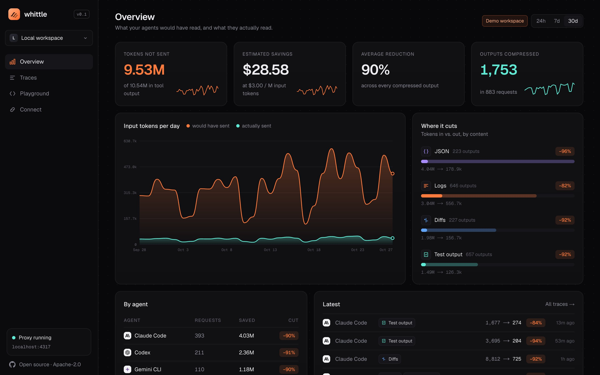
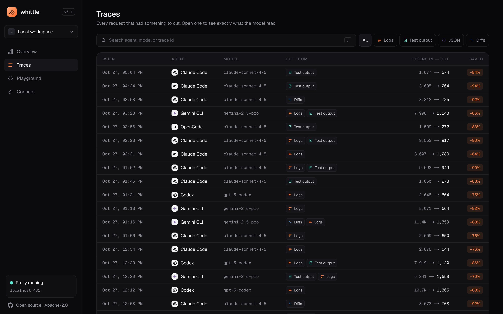
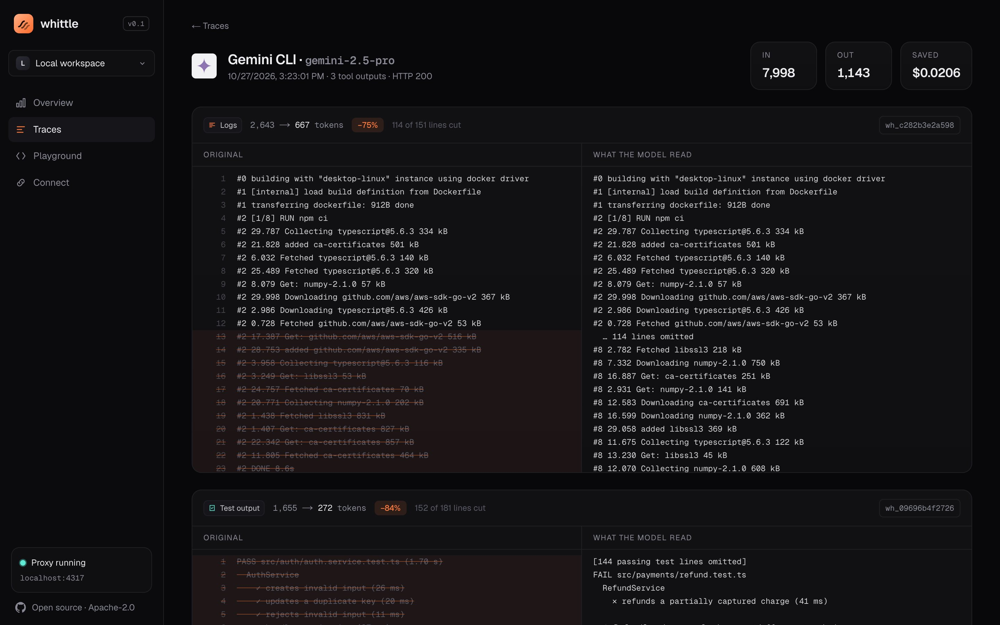
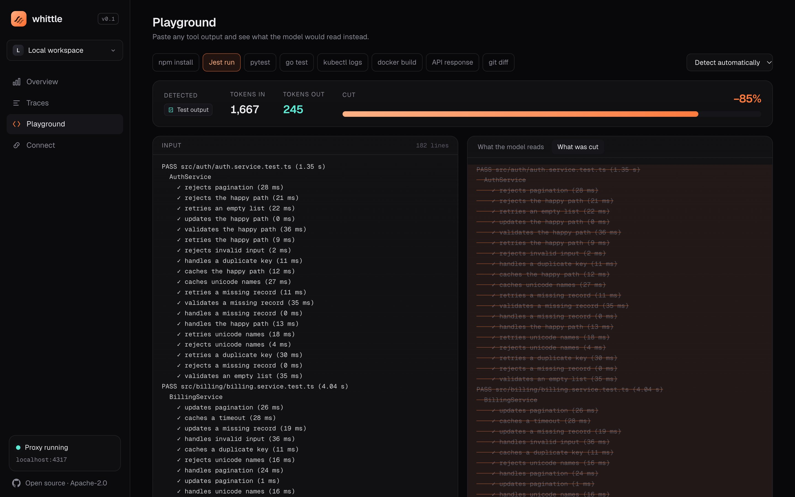
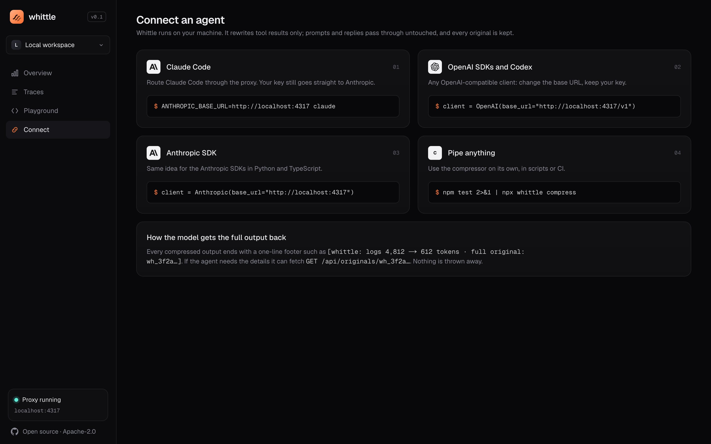

<p align="center"></p>

# whittle

**Make coding agents read less.** Whittle is a local proxy and CLI that compresses the tool output your agents read (logs, test runs, JSON, diffs) before it reaches the model. It keeps every original, and its dashboard shows exactly what was cut.

Agents spend most of their input tokens reading tool output: 200 passing tests to find the one that failed, a health-check log to find one error, a 40-item API response to read one field. Whittle keeps the parts an agent acts on and folds the rest.

```bash
npm test 2>&1 | npx whittle compress
ANTHROPIC_BASE_URL=http://localhost:4317 claude
```

## What it does to real output

Measured on the bundled samples (`src/core/samples.ts`), with tokens counted using the o200k encoding:

| Output | Detected as | Tokens in | Tokens out | Cut |
| --- | --- | ---: | ---: | ---: |
| npm install | logs | 3,620 | 1,285 | −65% |
| Jest run | tests | 1,667 | 274 | −84% |
| pytest | tests | 3,683 | 203 | −94% |
| go test | tests | 1,561 | 118 | −92% |
| kubectl logs | logs | 8,054 | 675 | −92% |
| docker build | logs | 2,628 | 656 | −75% |
| API response | json | 18,171 | 822 | −95% |
| git diff | diff | 8,675 | 720 | −92% |

The tests in `src/core/core.test.ts` check that what matters survives: the failing test and its assertion, the ERESOLVE explanation, the `context deadline exceeded` error, every changed line of a diff.

## How each kind is handled

- **Logs:** strips ANSI codes, progress bars and timestamps. Folds runs of near-identical lines (same shape once numbers, IDs, paths and URLs are blanked) into one line with a count. If the result is still long, it keeps the head, the tail, and every error or warning with two lines of context.
- **Test output** (Jest, Vitest, pytest, `go test`, Mocha): drops passing lines and keeps failures, assertion messages, `file:line` locations and the summary. Very long stack traces are capped.
- **JSON:** stays valid JSON. Minifies it, drops null and empty fields, keeps the first three items of long arrays with a `"… 37 more items"` marker, and shortens very long strings.
- **Diffs:** keeps every changed line plus one line of context, and all file and hunk headers. Lockfiles and generated files become a one-line `+N −M` summary. Large new files are capped.

Outputs under 300 tokens pass through untouched, and so does anything Whittle can't shrink by at least 10%.

## Nothing is lost

Every compressed output ends with a footer:

```
[whittle: logs 8,054 → 647 tokens · full original: wh_02c021d6b078]
```

The original is stored locally. The agent, or you, can fetch it with `GET /api/originals/wh_02c021d6b078`.

## Run it

```bash
git clone https://github.com/officialasishkumar/whittle && cd whittle
npm install
npm run build && npm start          # proxy + dashboard on http://localhost:4317
npm run seed                        # optional: a 30-day demo workspace
```

Requires Node 22.13 or later. Whittle uses the built-in `node:sqlite`, so there's no database to install. Data lives in `~/.whittle/whittle.db`; set `WHITTLE_DB` to change that.

### Connect an agent

| Client | Setting |
| --- | --- |
| Claude Code | `ANTHROPIC_BASE_URL=http://localhost:4317 claude` |
| Anthropic SDK | `Anthropic(base_url="http://localhost:4317")` |
| OpenAI SDK, Codex, OpenAI-compatible tools | `OpenAI(base_url="http://localhost:4317/v1")` |
| Anything else | `… | npx whittle compress` |

Your API key goes straight through to the provider. Whittle only rewrites tool results (`tool_result` blocks for Anthropic, `role: "tool"` messages for OpenAI). Prompts, system messages and the model's replies pass through untouched, and responses, including streams, are piped back as-is.

| Variable | Default |
| --- | --- |
| `WHITTLE_DB` | `~/.whittle/whittle.db` |
| `WHITTLE_ANTHROPIC_UPSTREAM` | `https://api.anthropic.com` |
| `WHITTLE_OPENAI_UPSTREAM` | `https://api.openai.com` |
| `WHITTLE_PRICE` | `3` (USD per million input tokens, for the savings estimate) |
| `WHITTLE_DISABLE` | unset; `1` turns compression off while still logging |

## The dashboard

| | |
| --- | --- |
|  |  |
|  |  |

- **Overview:** tokens not sent, estimated savings, a before-and-after chart per day, and savings broken down by content kind and by agent.
- **Traces:** every request that had something to cut. Open one to see the original with each removed line struck through, next to what the model actually read.
- **Playground:** paste any output, or pick a preset, and watch the cut live.

The screenshots use the seeded demo workspace. Its tool outputs are synthetic, but every number comes from running the real compressor over them.

## Develop

```bash
npm run dev        # http://localhost:4317
npm test           # compressor and proxy tests (the proxy test runs against a fake upstream)
npm run lint && npm run typecheck
```

`src/core` holds the compressor and has no framework dependencies. `src/relay.ts` is the proxy and `src/store.ts` the SQLite layer. `app/` contains the Next.js dashboard and the `/v1/*` routes.

## Roadmap

- Trimming filler from model replies, as an opt-in
- Per-project rules (always keep lines matching X)
- MCP tool results
- A hosted team view

## License

Apache-2.0
